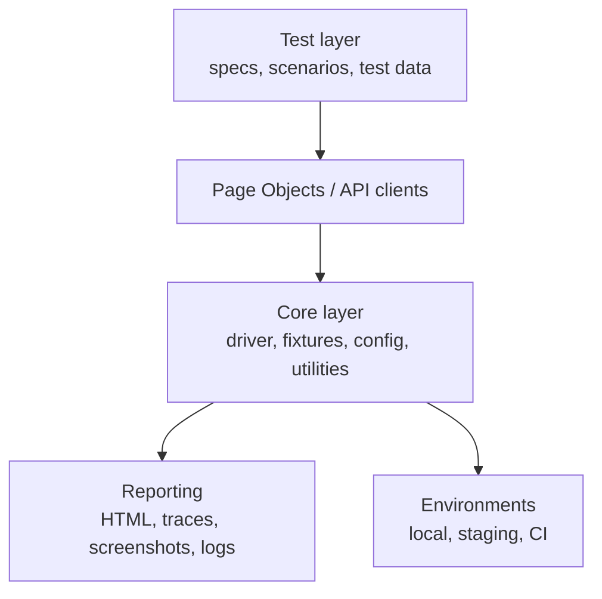

<div align="center">


<a href="https://github.com/richasharma-testcraft">
  
</a>

<br/>

[](https://www.upwork.com/freelancers/~01ddc41dc7980f70ea?mp_source=share)
[](https://www.linkedin.com/in/richa-sharma-467714388)
[](https://www.upwork.com/freelancers/~01ddc41dc7980f70ea?mp_source=share)


<br/><br/>


</div>

---

## 👋 About Me

I'm an **SDET** who treats test automation as real software engineering: clean architecture, version control, code review, and pipelines that give a team fast, trustworthy feedback.

I help startups and small teams replace slow, flaky or missing testing with **maintainable UI and API automation that runs in CI**.

> 🧠 **My approach:** tests are code. They should be readable, reusable, deterministic, and cheap to maintain.

<div align="center">


</div>

---

## 🏗️ What I Can Build

> ⭐ **I design and build automation frameworks from scratch and integrate them with Jenkins CI/CD.**

| Service | What you get |
| --- | --- |
| 🏗️ **Automation framework from scratch** | A clean, scalable framework (Playwright/TypeScript or Selenium/Java/TestNG) with Page Objects, config management, reusable utilities and reporting |
| 🔁 **Jenkins integration** | Your framework wired into a Jenkins pipeline (`Jenkinsfile`) with parameterized suite runs, test reports and archived artifacts |
| 🎭 **Playwright E2E testing** | Cross-browser tests with fixtures, traces, screenshots and HTML reports |
| 🔌 **API test automation** | REST Assured or Postman suites with assertions, schema checks and reusable test data |
| ☕ **Selenium framework work** | Java + TestNG + Maven frameworks built, cleaned up, or migrated toward Playwright |
| 🧪 **Flaky test rescue** | Root-cause analysis of unstable tests and a concrete plan to stabilize them |
| ✅ **Regression and smoke suites** | Prioritized, automated coverage of your critical user flows |

### 📦 Ways to Work Together

| Package | Best for |
| --- | --- |
| 🔍 **Test Automation Audit** | A review of your current tests and CI, with a clear prioritized improvement plan |
| 🚀 **Framework Starter** | A new, well-structured automation framework set up for your app |
| 🔗 **Framework + Jenkins Setup** | A framework delivered together with its Jenkins pipeline, ready for your team to run |
| 🔧 **Rescue and Stabilize** | An existing flaky or slow suite made reliable and faster |

> 💬 Scope and pricing are tailored to your project. Tell me what you're testing and I'll suggest a first step.

---

## 🧱 Framework Architecture I Build



## 🔁 Framework to Jenkins, End to End

<div align="center">


</div>

<details>
<summary><b>👀 Example of a Jenkins pipeline I set up (illustrative)</b></summary>
<br/>

```groovy
pipeline {
  agent any

  tools {
    maven 'Maven3'
    jdk 'JDK17'
  }

  parameters {
    choice(name: 'SUITE', choices: ['smoke', 'regression'], description: 'Test suite to run')
  }

  stages {
    stage('Checkout') {
      steps { checkout scm }
    }
    stage('Build') {
      steps { sh 'mvn -B clean compile' }
    }
    stage('Test') {
      steps { sh "mvn -B test -Dsuite=${params.SUITE}" }
    }
  }

  post {
    always {
      junit 'target/surefire-reports/*.xml'
      archiveArtifacts artifacts: 'target/**/*.html', allowEmptyArchive: true
    }
  }
}
```

</details>

---

## ⚙️ How I Work

1. **Understand** the product, risks and what actually needs protecting
2. **Design** a framework structure that fits the team and the stack
3. **Build** readable, deterministic tests with stable locators and clean data setup
4. **Integrate** into Jenkins or GitHub Actions with useful reports, traces and failure artifacts
5. **Hand off** with documentation so your team can maintain and extend it

---

## 🛠️ Tech Stack

<div align="center">


<br/><br/>


</div>

| Area | Tools |
| --- | --- |
| **UI automation** | Playwright, Selenium WebDriver, TestNG, Page Object Model |
| **API testing** | REST Assured, Postman |
| **Languages** | TypeScript, JavaScript, Java |
| **Framework design** | Page Objects, fixtures, config management, reporting |
| **CI/CD and tooling** | Jenkins (Jenkinsfile pipelines), GitHub, Maven, Jira |

---

<!--
## 🚀 Featured Projects
Uncomment and edit this section as each demo repo goes live.

| Project | What it shows | Stack |
| --- | --- | --- |
| [playwright-ts-framework](https://github.com/richasharma-testcraft/playwright-ts-framework) | End-to-end framework with Page Objects, fixtures, reporting and CI | Playwright, TypeScript, GitHub Actions |
| [selenium-testng-jenkins](https://github.com/richasharma-testcraft/selenium-testng-jenkins) | Selenium framework with POM, TestNG and a Jenkinsfile | Java, Selenium, TestNG, Maven, Jenkins |
| [api-automation-restassured](https://github.com/richasharma-testcraft/api-automation-restassured) | API test suite with reusable specs and reports | Java, REST Assured, TestNG, Maven |
-->

<!--
## 📊 GitHub Stats
Uncomment after a few weeks of activity; stat cards look empty on a new profile.

<div align="center">
  
  
</div>
-->

<!--
## 🐍 Contribution Snake
Uncomment after adding .github/workflows/snake.yml and running it once.

<div align="center">
  <picture>
    <source media="(prefers-color-scheme: dark)" srcset="https://raw.githubusercontent.com/richasharma-testcraft/richasharma-testcraft/output/github-snake-dark.svg" />
    
  </picture>
</div>
-->

## 💼 Experience

<details>
<summary><b>QA Automation Engineer, Dilato</b> · June 2026 – Present</summary>
<br/>

UI automation with Playwright, end-to-end workflow coverage, regression support and failure investigation.

</details>

<details>
<summary><b>Software Test Engineer, TEKPYRAMID</b> · November 2025 – May 2026</summary>
<br/>

Manual and automated testing with Selenium (Java), TestNG and Page Object Model.

</details>

<details>
<summary><b>Software QA Trainee, QSPIDERS</b> · January 2025 – October 2025</summary>
<br/>

Manual testing, Core Java, Selenium WebDriver and API testing fundamentals.

</details>

---

<div align="center">

### 📫 Let's build something reliable together

[](https://www.upwork.com/freelancers/~01ddc41dc7980f70ea?mp_source=share)
[](https://www.linkedin.com/in/richa-sharma-467714388)
[](https://github.com/richasharma-testcraft)

<sub>This profile contains independent demonstration projects created to showcase test automation skills. No employer or client proprietary code, credentials, test data, or confidential information is included.</sub>


name: Generate Snake Animation

on:
  schedule:
    - cron: "0 */12 * * *"
  workflow_dispatch:
  push:
    branches: [main]

permissions:
  contents: write

jobs:
  generate:
    runs-on: ubuntu-latest
    steps:
      - uses: Platane/snk/svg-only@v3
        with:
          github_user_name: ${{ github.repository_owner }}
          outputs: |
            dist/github-snake.svg
            dist/github-snake-dark.svg?palette=github-dark

      - uses: crazy-max/ghaction-github-pages@v3.1.0
        with:
          target_branch: output
          build_dir: dist
        env:
          GITHUB_TOKEN: ${{ secrets.GITHUB_TOKEN }}

</div>
