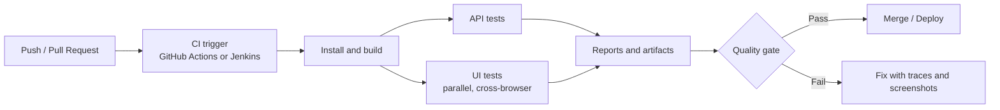

<div align="center">


<a href="https://github.com/richasharma-testcraft">
  
</a>

<br/>

[](https://www.upwork.com/freelancers/~01ddc41dc7980f70ea?mp_source=share)
[](https://www.linkedin.com/in/richa-sharma-467714388)
[](https://www.upwork.com/freelancers/~01ddc41dc7980f70ea?mp_source=share)

</div>

---

## 👋 About Me

I'm a **Software Development Engineer in Test (SDET)**. I treat test automation as software engineering: clean architecture, reusable components, fast feedback in CI, and reports a whole team can trust.

I help startups and small teams replace slow, flaky, hard-to-maintain testing with **automation that scales with the product**.

- 🎭 **Playwright + TypeScript** for modern, fast end-to-end testing
- ☕ **Selenium + Java + TestNG** for structured, framework-based automation
- 🔌 **REST Assured and Postman** for API testing
- 🔁 **Jenkins and GitHub Actions** for continuous testing in the pipeline

---

## 🤝 How I Can Help

| Service | What you get |
| --- | --- |
| 🏗️ **Test framework architecture** | A scalable framework: Page Objects, fixtures, config per environment, reusable utilities, clear folder structure |
| 🎭 **Playwright E2E automation** | Cross-browser end-to-end tests with HTML reports, traces and parallel execution |
| 🔌 **API test automation** | REST Assured or Postman suites with assertions, schema validation and reusable test data |
| 🔁 **CI/CD quality gates** | Tests that run on every push or pull request (Jenkins or GitHub Actions) and block bad builds |
| 🧪 **Flaky test rescue** | Root-cause analysis of unstable tests and fixes for waits, data, selectors and test isolation |
| 🔄 **Selenium → Playwright migration** | Move legacy suites to a faster, more reliable stack in stages |
| 📋 **Test automation audit** | A short review of your current suite with prioritized recommendations |

> 💬 A small fixed-price audit or setup is the best way to start. Tell me what you're testing and I'll suggest a first step.

---

## 🧠 How I Think About Test Automation

- **Test the right layer.** Cover logic through API tests, keep UI tests for critical user journeys, and keep the suite fast.
- **Tests are code.** They get reviews, clear naming, reusable components and no copy-paste.
- **Stability over volume.** A smaller suite that's green for the right reasons beats hundreds of flaky tests.
- **Fast, visible feedback.** Failures should say what broke and why, with reports, traces and screenshots.
- **Independent tests.** No shared state, no ordering dependencies, safe to run in parallel.

<details>
<summary><b>🔁 The pipeline I typically set up</b></summary>
<br/>



</details>

<details>
<summary><b>🧩 How I structure UI tests (Playwright + TypeScript, illustrative)</b></summary>
<br/>

```ts
// pages/LoginPage.ts
import { Page, expect } from '@playwright/test';

export class LoginPage {
  constructor(private readonly page: Page) {}

  async open() {
    await this.page.goto('/');
  }

  async login(username: string, password: string) {
    await this.page.getByPlaceholder('Username').fill(username);
    await this.page.getByPlaceholder('Password').fill(password);
    await this.page.getByRole('button', { name: 'Login' }).click();
  }

  async expectLoggedIn() {
    await expect(this.page).toHaveURL(/inventory/);
  }
}
```

```ts
// tests/login.spec.ts
import { test } from '@playwright/test';
import { LoginPage } from '../pages/LoginPage';

test('registered user can log in', async ({ page }) => {
  const login = new LoginPage(page);
  await login.open();
  await login.login(process.env.USER_NAME!, process.env.USER_PASSWORD!);
  await login.expectLoggedIn();
});
```

Page Objects keep selectors in one place, tests read like user stories, and credentials come from environment variables, never from the code.

</details>

---

## 🛠️ Tech Stack

<div align="center">


<br/>


</div>

---

<!--
## 🚀 Featured Projects
Uncomment and edit this section as each demo repo goes live.

| Project | What it shows | Stack |
| --- | --- | --- |
| [playwright-ts-framework](https://github.com/richasharma-testcraft/playwright-ts-framework) | E2E framework with Page Objects, fixtures, reporting and CI | Playwright, TypeScript, GitHub Actions |
| [api-automation-restassured](https://github.com/richasharma-testcraft/api-automation-restassured) | API test suite with reusable specs, schema checks and reports | Java, REST Assured, TestNG, Maven |
| [selenium-testng-framework](https://github.com/richasharma-testcraft/selenium-testng-framework) | Selenium framework with POM, TestNG and Jenkins pipeline | Java, Selenium, TestNG, Jenkins |
-->

<!--
## 📊 GitHub Stats
Uncomment after a few weeks of activity; stat cards look empty on a new profile.

<div align="center">
  
  
</div>
-->

## 💼 Experience

<details>
<summary><b>QA Automation Engineer, Dilato</b> · June 2026 – Present</summary>
<br/>

UI automation with Playwright, end-to-end workflow coverage, regression support and failure investigation.

</details>

<details>
<summary><b>Software Test Engineer, TEKPYRAMID</b> · November 2025 – May 2026</summary>
<br/>

Manual and automated testing with Selenium (Java), TestNG and Page Object Model.

</details>

<details>
<summary><b>Software QA Trainee, QSPIDERS</b> · January 2025 – October 2025</summary>
<br/>

Manual testing, Core Java, Selenium WebDriver and API testing fundamentals.

</details>

---

<div align="center">

### 📫 Let's build something reliable together

[](https://www.upwork.com/freelancers/~01ddc41dc7980f70ea?mp_source=share)
[](https://www.linkedin.com/in/richa-sharma-467714388)
[](https://github.com/richasharma-testcraft)

<sub>This profile contains independent demonstration projects created to showcase QA automation skills. No employer or client proprietary code, credentials, test data, or confidential information is included.</sub>


</div>
